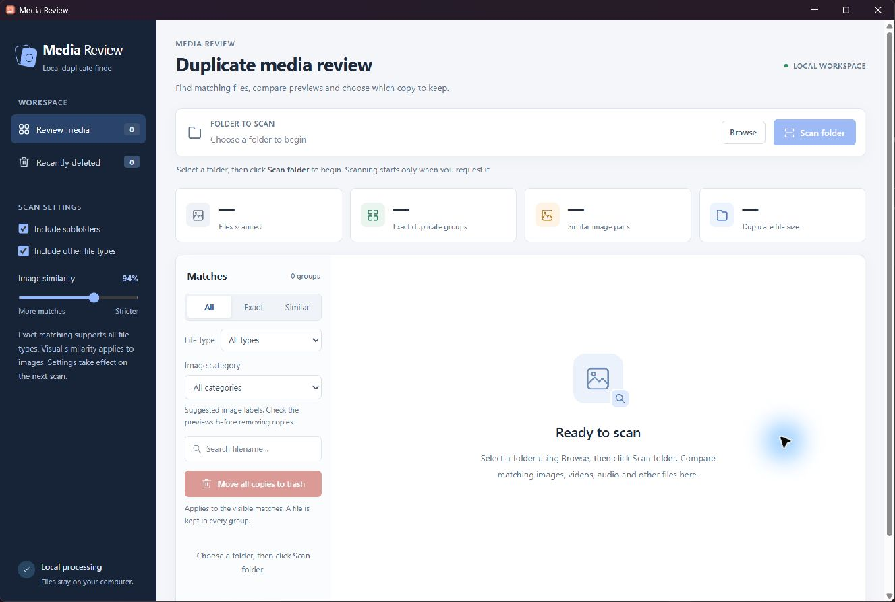
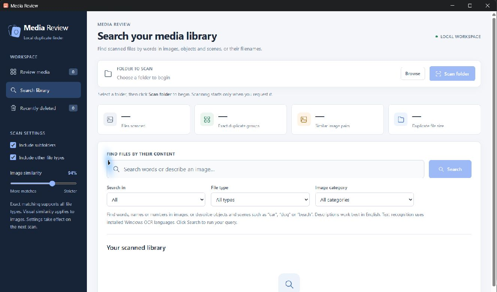
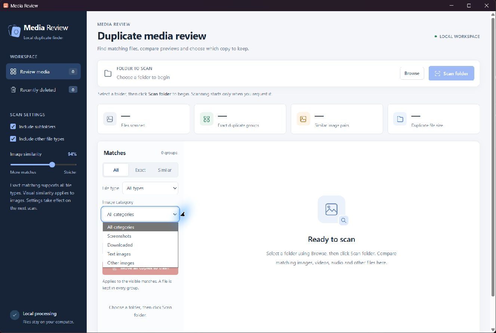

# Media Review

A local Windows desktop app for finding media by image content, reviewing duplicate files side by side, and removing unwanted copies recoverably.

Media Review opens in a single desktop window. Choose a folder and click **Scan folder** to begin. Your files stay on your computer.



## Features

- Exact duplicate detection for every file type, including unknown extensions and files without an extension.
- Decoded image matching and adjustable visual similarity suggestions.
- Side-by-side image previews, video playback, audio playback, and file details.
- HEIC/HEIF support alongside common image formats.
- Combined Screenshots, Downloaded, Text images, and Other images filters.
- Search words, names, and numbers recognized inside images, including short text.
- Find images by objects and scenes, such as **car**, **dog**, or **beach**, using an offline CLIP model.
- Search every scanned file, including files without duplicates, with filename and content search modes.
- Recoverable removal with a confirmation, Undo, and a recovery history.
- Bulk removal of copies in the current All, Exact, or Similar results, with a file list and confirmation before anything moves.
- Explicit scanning and playback: opening the app or choosing a folder starts neither.

## Getting started

Use the complete Windows release folder, or the executable produced by the build below. Keep its **models** folder beside **Media Review.exe**. Run the executable on a 64-bit Windows 10 or Windows 11 computer with the [Microsoft Edge WebView2 Runtime](https://developer.microsoft.com/en-us/microsoft-edge/webview2/) installed.

1. Click **Browse** and choose a folder, or enter a folder path.
2. Choose whether to include subfolders and other file types, then click **Scan folder**.
3. Select a duplicate group and compare the two selected files. Use the file type and image category filters to narrow the results.
4. Choose the copy to keep, select **Move copy to trash**, and confirm the filenames.
5. Use **Undo** or **Recently deleted → Restore file** if needed.

The app starts with no folder selected and no scan running. Choosing a folder or pressing Enter does not start a scan. Restoring a file updates the current results without rescanning the folder. Opening the app again brings the existing desktop window to the front.

### Search media content



After scanning, open **Search library**. Enter a name, word, number, object, or scene description, then click **Search**, or press Enter while the query field is focused. Search includes all files in the current scan, even files with no duplicate matches.

| Search in | Finds |
| --- | --- |
| All | Text recognized inside images, matching filenames, and relevant image content. |
| Text in images | Words, names, and numbers recognized by Windows OCR. |
| Objects & scenes | Images that resemble an English description, such as **red car** or **beach sunset**. |
| Filenames | Matching filenames and paths relative to the scanned folder, across all scanned file types. |

Use the search view's **File type** and **Image category** selectors to narrow the next query, then click **Search** again. Results identify text matches, filename matches, and approximate visual suggestions. Open a preview to inspect a result, or use **Show in folder** to select its file in Windows Explorer. Search results do not provide duplicate-removal controls.

OCR and visual indexing run during the explicitly requested folder scan. Large image libraries can take longer to scan. The content index stays in memory for the current scan; changing the scan or closing the app clears it. Editing the query or changing views does not start scanning or searching.

Text search uses installed Windows OCR languages and can find a single recognized name or number even when the image is not labeled **Text images**. Recognition may miss small, stylized, or unsupported-language text. Object and scene search works best with English descriptions. CLIP similarity is a relevance suggestion, not an identification or confidence guarantee; it does not identify people by name. Images are indexed from their decoded still image, including the first frame of a GIF. Video, audio, and other files support filename search; their frames, speech, and contents are not indexed.

The release includes local visual-search models. If they are missing or damaged, the app reports that visual search is unavailable; filename search, available OCR text search, and duplicate review continue to work. The app never downloads missing models automatically.

### Image categories



The **Image category** selector works together with **All**, **Exact**, **Similar**, file type, and filename search. Images can have more than one label: a screenshot containing words can appear under both **Screenshots** and **Text images**.

Choose **All categories** to remove the category restriction. Video, audio, and other files remain available through **File type** when no image category is selected.

| Category | Detection |
| --- | --- |
| Screenshots | Capture-related filename prefixes, screenshot folders, or image software metadata. |
| Downloaded | Downloads folders, download-related filename prefixes, or Windows Internet-zone metadata. |
| Text images | Text recognized inside the decoded image by the local Windows OCR engine. |
| Other images | Images without any of these suggested labels. |

Capture and download labels are suggestions; a renamed or moved image may no longer retain its origin clues. Text recognition uses an installed Windows OCR language, and it can miss small, stylized, or unsupported-language text. An unavailable or failed recognition attempt is reported rather than treated as proof that an image has no text. Recognized words are retained in memory for content search during the current scan. The app does not save a text index to disk or upload recognized words.

Selecting a category shows matching duplicate groups. A file outside the category may still be shown as the copy to keep. Individual and bulk removal target only copies matching the selected category. When available, a nonmatching file is kept by default; an explicitly selected keeper is always protected.

### Remove multiple copies

Choose **All**, **Exact**, or **Similar**, and optionally narrow the results by file type, image category, or filename. Click **Move all copies to trash** to review the removal plan for the visible groups. The confirmation shows how many files will move, their total size, their locations, and the files that will be kept. With an image category selected, copies outside that category stay in their original folders.

The copy currently marked **Keep this file** is preserved in the active group. Other groups prefer a file outside the selected image category, when available, then use the largest image dimensions and file size; ties use the group's original order. Keepers shared by overlapping groups are protected, so a group can retain more than one file. Each copy moves at most once.

Similar images can be different photos. Review the planned filenames before confirming a bulk move. Files changed or removed since the scan reject the plan before any copies move. If a later move fails, successfully moved files remain recoverable and the app reports the files that stayed in place. Restore individual copies from **Recently deleted**.

## How matching works

| Match | Meaning |
| --- | --- |
| Exact copies | The full contents are byte-for-byte identical. Available for all file types when **Include other file types** is enabled. |
| Same image | The decoded image pixels are identical, even if file metadata differs. |
| Similar photos | Images have a similar appearance. These are review suggestions; different moments and edited photos may appear together. |

Lower the image matching threshold to see more suggestions. Videos, audio, and other files are compared by their full contents. Re-encoded media with different contents is not identified as an exact copy.

Image previews include JPEG, PNG, WebP, BMP, TIFF, GIF (first frame), HEIC/HEIF, AVIF, and other formats supported by the installed image decoder. Rotation metadata is respected.

FFmpeg prepares video and audio previews on demand, including common MP4, MOV, MKV, AVI, WebM, MP3, WAV, FLAC, AAC, and OGG files. Playback previews cover the first **120 seconds**. The original file is never converted or changed. Unsupported, damaged, or encrypted media shows a file-information placeholder and can still participate in exact duplicate detection.

## Recovery and privacy

Removed files are moved into **.photo-review-trash** inside the scanned folder. They are not permanently erased, and they continue to use disk space. Keep this recovery folder until you no longer need the removed copies. Restore refuses to overwrite an existing file.

Scanning, comparison, and preview processing happen locally. The desktop interface uses a server bound to the loopback address on a dynamically assigned port. It does not upload your files or require an account. Preview conversion may create temporary local files, which are cleaned up when the app closes.

OCR text and image embeddings stay in process memory; there is no saved search database. A new scan or app close clears the previous content index. Search responses contain result details and short matching text snippets, without exposing the complete OCR or embedding index. Visual inference runs on the CPU with ONNX Runtime telemetry disabled. Model preparation is a separate, explicit setup action; app startup, folder selection, scanning, and searching make no model download requests.

## Run from source

Use Python 3.12 on Windows. From the repository folder, create and activate a virtual environment:

```powershell
py -3.12 -m venv .venv
.\.venv\Scripts\Activate.ps1
python -m pip install -r requirements.txt
python tools/fetch_search_models.py
python launcher.py
```

The desktop interface requires WebView2. Text detection and OCR search use installed Windows OCR language resources through the pinned PyWinRT dependencies. If no recognition language is available, the other filters and duplicate review continue to work. FFmpeg is optional for scanning and image review; it is needed for video and audio previews. See the build instructions to prepare the bundled decoder.

`fetch_search_models.py` is an explicit setup download from the pinned `Xenova/clip-vit-base-patch32` model revision. It verifies fixed file sizes and SHA-256 hashes before installing the two quantized ONNX encoders and tokenizer/configuration files, about 156 MB in total. A release's `source` folder uses its sibling `models` folder; a standalone GitHub checkout uses `models` inside the checkout. The downloaded files are excluded from Git. Once prepared, model inference needs no network connection. Preserve the model license and notice supplied with those files.

For development, the same interface can also run in a browser:

```powershell
python app.py
```

This optional mode also waits for an explicit **Scan folder** action.

## Build the Windows executable

Install the development dependencies and prepare FFmpeg and the search models, then build:

```powershell
python -m pip install -r requirements-dev.txt
python tools/fetch_ffmpeg.py
python tools/fetch_search_models.py
python build_windows.py
```

The build creates **dist/Media Review.exe**. The executable includes Python and the application dependencies; users still need the WebView2 Runtime. Copy the prepared **models** folder beside the executable before distributing it. The model weights are companion files, rather than embedded in the executable or the source ZIP. Build on 64-bit Windows with Python 3.12.

The application source is MIT licensed. Packaged dependencies, including the supplied GPL FFmpeg and HEIF decoder binaries, retain their own licenses. Review [THIRD_PARTY_NOTICES.md](THIRD_PARTY_NOTICES.md) before distributing an executable.

## Tests

```powershell
python -m unittest discover -s tests -v
```

Tests create disposable media fixtures. They do not scan a personal media folder. Search tests exercise text, filenames, unique files, filtering, paging, and private-index handling with generated or mocked inputs. Actual model inference and Windows OCR should also be checked in the complete release environment. FFmpeg integration tests are skipped when the decoder is unavailable; a Windows symlink test may be skipped when the account cannot create symlinks. The Windows CI workflow installs the decoder to exercise media preview conversion.

## Project layout

```text
app.py                  Local HTTP API, library search, and preview handling
launcher.py             Desktop window and application lifecycle
scanner.py              Duplicate detection and media classification
image_filters.py        Local image labels and in-memory Windows OCR text
visual_search.py        Offline CLIP inference and verified model assets
storage.py              Recoverable removal and restoration
static/                 Desktop interface HTML, CSS, and JavaScript
tests/                  Generated-fixture test suite
tools/                  Dependency preparation utilities
build_windows.py        Windows executable packaging
licenses/               Dependency and model license texts
```

## Contributing

See [CONTRIBUTING.md](CONTRIBUTING.md) for development and review guidelines. Keep personal media, generated binaries, dependency folders, logs, and scan reports out of the repository.

## License

The application source is available under the [MIT License](LICENSE). Third-party components are covered by their respective licenses; see [THIRD_PARTY_NOTICES.md](THIRD_PARTY_NOTICES.md).
