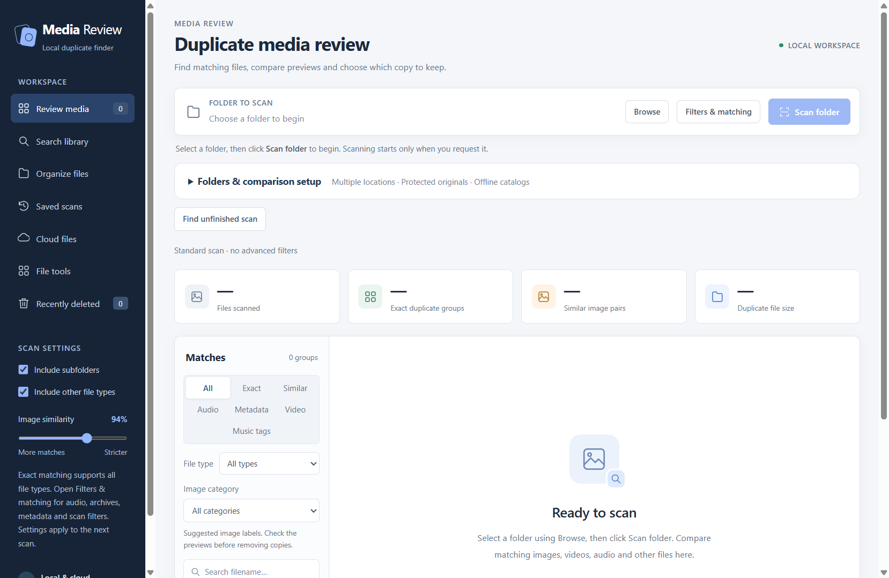

# Media Review 3.0

A Windows desktop app for finding duplicate media, searching image contents, comparing copies, and organizing local or connected cloud files.

Media Review opens in one desktop window. Choose your locations and click **Scan folder** to start. Selecting folders, opening views, and reopening the app never start a media scan automatically. Local analysis stays on your computer; optional cloud connections are authorized separately.



## Features

| Area | Available functions |
| --- | --- |
| Workspace | Up to 32 separate folders or drives; protected originals; reference libraries; within-folder, cross-folder and reference comparisons. |
| Duplicate files | Full-content exact matching for every file type, including unknown extensions and extensionless files. |
| Photos | Decoded-pixel matches; adjustable visual suggestions; optional rotation, flip and bounded crop comparison; HEIC/HEIF and common decoder-supported formats. |
| Videos | Optional similar-video suggestions using eight distributed frame samples; transformed-frame comparison; synchronized sampled timelines. |
| Audio | Optional acoustic fingerprints across supported formats; separate selected music-tag matching. |
| Folders | Recognition of complete matching folder contents and structure for read-only review. |
| Scan controls | Manual start, pause, resume and stop; persistent completed-file cache; explicit continuation after an interrupted run. |
| Saved libraries | Explicit save/reopen of validated scan results; read-only offline catalogs; comparison with disconnected drive catalogs. |
| Filters | Extensions, exclusions, size, modified dates and image dimensions; Screenshots, Downloaded, Text images and Other images categories. |
| Search | Filename search across the library, local Windows OCR words/names/numbers, and offline CLIP object/scene search. |
| Review | Side-by-side previews, full-size images, linked image zoom/pan, audio/video playback, file details and configurable keep rules. |
| File tools | CSV duplicate report; batch rename; empty-folder cleanup; verified hard links; Windows Recycle Bin; explicit app-trash emptying. |
| Local organization | Previewed file-type or year folders for the primary scanned location, with collision handling and persistent undo. |
| Recovery | Recoverable app trash; bulk-copy removal plans; restoration history; undo for supported local file operations. |
| Archives | Bounded read-only ZIP, RAR, 7z and TAR member scanning, preview and eligible matching/search. |
| Photo metadata | Optional capture-time, camera and GPS suggestions. |
| Cloud | Google Drive, OneDrive and Dropbox checksum review; confirmed in-account moves, file-type/year organization, recoverable cloud trash and restoration. |

## Getting started

Use the complete Windows release folder. Keep **models** beside **Media Review.exe**, then run the executable on 64-bit Windows 10 or 11 with the [Microsoft Edge WebView2 Runtime](https://developer.microsoft.com/en-us/microsoft-edge/webview2/) installed.

1. Click **Browse** and choose your primary folder.
2. Open **Folders & comparison setup** to add other folders or drives and assign roles.
3. Review **Filters & matching**, then click **Scan folder**.
4. Select a duplicate group and compare its files. Choose the original to keep before removing copies.
5. Review each proposed operation and confirm it. Recover local app-trash files through **Recently deleted**.

The first selected folder is the primary folder used by ordinary **Organize files**. Other selected roots participate in review and supported File tools. Selected roots must be separate: one cannot contain another. Linked roots and linked ancestors are refused.

### Folder roles and comparison scope

- **Review & manage** allows supported confirmed file operations.
- **Protected originals** includes files in comparison but prevents their rename, move, removal or replacement.
- **Reference library** is protected and can serve as the reference side of comparisons.

In **Filters & matching**, choose all selected locations, different selected folders only, or comparisons against reference libraries. Reference mode requires at least one reference root. Changing a role or matching option affects the next explicit scan; it does not alter the current library automatically.

### Pause, stop and continue after reopening

Use **Pause** to stop a local worker at its next safe checkpoint, then **Resume** to continue the same run. **Pausing…** means the current decoder, OCR call, inference or other safe step is still finishing. Pausing keeps file-changing operations locked. **Stop scan** releases a paused worker and keeps fully processed files, clearly marked as incomplete.

**Reuse completed file analysis** is enabled by default. Its persistent local cache reuses unchanged file records for matching settings, including hashes, OCR text, image embeddings and optional media analysis. Changed files are analyzed again. Cache reuse accelerates repeat scans; it is not a substitute for the full-content checks required before file-changing operations.

If a scan is interrupted by closing or restarting the app, choose **Find unfinished scan**, then **Resume unfinished scan**. This explicitly starts a refreshed discovery and comparison pass using the saved folder/settings checkpoint and any reusable completed-file cache. It does not restore the old worker or its exact comparison position. Previously completed analysis is reusable only when caching was enabled and its records are still available; otherwise those files are analyzed again. Nothing resumes automatically.

### Saved scans and offline catalogs

After a completed or stopped local scan, open **Saved scans**, enter a name and select **Save current scan**. This saves locations, settings, hashes, metadata and available content indexes to the current Windows user's application data. It does not copy original media.

**Open scan** verifies existing locations and full contents, skips changed or missing files, and reports an incomplete library when necessary. It does not discover newly added files; start another explicit scan for an up-to-date library.

**Open as catalog** opens the saved snapshot without requiring its drive to be connected. Catalog entries are read-only and their original media cannot be previewed or changed. In **Folders & comparison setup → Compare with saved drive catalogs**, select catalogs to compare against a new local scan. Offline entries cannot authorize removing the only available local copy. Reconnect the drive and scan it to use ordinary preview and file-management controls.

Saved results and catalogs are snapshots, not live background monitoring. A saved scan is limited to 128 MB and can reject libraries whose stored indexes exceed that limit.

## Filters and matching

Open **Filters & matching** before scanning. Settings apply to the next explicit scan.

| Choice | Behavior |
| --- | --- |
| Include extensions | Comma-separated extensions such as `jpg, png, mp3`; blank includes permitted types. |
| Exclusions | Relative folders or wildcards such as `Backups/**` and `*.tmp`. |
| Size | Minimum/maximum MiB; archive members use uncompressed sizes. |
| Modified dates | Inclusive local calendar dates. |
| Image dimensions | Minimum width/height; enabling either excludes non-image files. |
| Rotation and flip | Compares quarter-turn rotations and mirrored photo variants. |
| Cropped copies | Searches a bounded grid of crop windows; increases comparison time. |
| Similar videos | Compares distributed frame samples with an adjustable threshold. |
| Audio fingerprints | Suggests copies of the same recording across encodings. |
| Music tags | Matches chosen Artist/Title/Album fields, independent of audio fingerprints. |
| Complete folders | Reports complete matching directory structures and file contents. |
| Metadata | Capture-time tolerance, optional same-camera requirement and GPS proximity. |
| Archive contents | Includes eligible read-only archive members. |

**Exact** means full contents match. **Same image** means decoded pixels match even if metadata differs. **Similar**, **Video**, **Audio**, **Audio tags** and **Metadata** groups are review suggestions; they are not proof that files can be discarded.

Rotated/flipped matching and crop matching use reduced samples and finite transformations. They do not promise arbitrary object detection or every possible crop. Video matching uses up to eight distributed frame samples and requires at least four informative matching positions. Durations must be within the greater of 1.5 seconds or 4%. It can suggest reencoded, scaled, rotated, flipped or modest centrally cropped copies; it does not perform arbitrary overlapping-clip or time-shifted segment search. A synchronized timeline aligns sampled positions, while loaded playback previews remain limited to the first 120 seconds.

Audio fingerprints analyze at most the first 30 minutes, tolerate short encoder delays, and reject silence and clips shorter than three seconds. They target copies of one recording, not guaranteed remix or live-version recognition. Music-tag matching requires nonempty matching selected fields after case normalization; different recordings can share those tags. Photo metadata can also describe different photographs taken close together.

Duplicate-folder recognition requires complete indexed ordinary-file contents and the same relative names/structure. Excluded, unavailable or linked entries can prevent a folder from qualifying. The folder list is read-only: it does not remove a whole directory automatically. Review its file groups and use confirmed file operations.

### Previews and image categories

Common decoder-supported images include JPEG, PNG, WebP, BMP, TIFF, GIF (first frame), HEIC/HEIF and AVIF. Image rotation metadata is respected. Recognized extensions do not guarantee that an installed decoder supports every RAW, vector or proprietary format. Unsupported or damaged files can still participate in exact matching.

FFmpeg prepares audio/video previews on demand, covering the first **120 seconds** without modifying originals. Playback starts only when requested. Use **Linked image comparison** to zoom both still images together and synchronize scrolling or dragging.

The image-category filter can combine **Screenshots**, **Downloaded**, **Text images** and **Other images**. A screenshot containing words may have multiple labels. Capture/download categories use filename, path and metadata clues; OCR supplies text-image labels. These are suggestions and can change when files are renamed or moved. File-type filters also retain video, audio and other files when no image category is selected.

### Search media content

After scanning, open **Search library**, choose a mode and enter a query. Click **Search** or press Enter in the query field.

| Mode | Searches |
| --- | --- |
| All | Recognized image text, filenames and approximate image content. |
| Text in images | Words, names and numbers recognized by installed Windows OCR languages. |
| Objects & scenes | Images resembling an English description such as **red car** or **beach sunset**. |
| Filenames | Names and paths across all scanned file types, including unique files. |

Search includes files without duplicates. Changing a query, view or filter does not automatically search. Result previews and **Show in folder** help locate a file; search is separate from duplicate removal.

OCR may miss small, stylized or unsupported-language words. CLIP relevance is a suggestion, not an identification or confidence guarantee, and does not identify people by name. Video frames, speech and document contents are not indexed for content search; non-image media supports filename search. Missing models produce an unavailable notice rather than an automatic download.

### Read-only archives

ZIP, RAR, 7z and TAR (including TAR.GZ, TAR.BZ2 and TAR.XZ) are supported. Bounded temporary extraction exposes member paths for eligible exact/image/audio/metadata comparisons, previews and image content search. Nested, linked, encrypted and unsafe entries are skipped.

Members cannot be deleted, moved, renamed, linked or repacked. Removal plans omit groups containing archive members. The container itself remains an ordinary file when permitted by filters. Temporary extraction does not rewrite the archive.

## Keep rules, removal and file tools

Open **File tools** after scanning or opening an available local scan.

| Tool | Behavior and recovery |
| --- | --- |
| Keep rules | Prefer image quality, newest/oldest modified date, a folder, ordered formats, or largest/smallest file. Protected originals take priority. Applying a rule changes review choices only. |
| CSV report | Exports duplicate groups, match type/score, paths, sizes and protection/offline flags. It does not export original media or the full OCR/embedding index. |
| Batch rename | Previews names for eligible ordinary files in the scanned library. Supports `{name}`, `{date}`, `{year}`, `{ext}` and `{counter:04d}`; dates use file modified time. Existing/repeated names reject the plan. Undo restores original paths. |
| Empty folders | Previews empty directories, including empty descendants, inside editable roots. Root/support folders are preserved. Undo recreates removed directories. |
| Hard links | Replaces verified exact copies on one filesystem with links to the keeper. Linked paths share content: editing one changes the others. Undo creates independent copies and needs space to do so. |
| Windows Recycle Bin | Sends verified exact duplicate copies to Windows' bin while preserving an available original. Restore these through Windows, not the app's Undo. |
| Finish cleaning app trash | Transfers recoverable copies to Windows' bin or permanently removes them. Permanent emptying requires the displayed confirmation and typing **DELETE**; it has no app restore. |

File tools operate on the current eligible library, not just the visible review filters. Rename plans include all eligible ordinary local files; hardlink and Recycle Bin plans target exact groups. Protected/reference folders, offline entries and archive members remain read-only. Every file-changing tool shows its own file list before confirmation. Durable operation history supports rename, hardlink and empty-folder undo and reports partial failures.

Normal review removal moves files into **.photo-review-trash** within each file's own scan root. Use **Recently deleted** to restore them. App trash retains the file bytes and continues using disk space. Moving them to Windows' bin also retains bytes until that bin is emptied.

**Move all copies to trash** plans removal for the currently filtered groups. Explicit keepers and shared keepers across overlapping groups stay protected. With an image category selected, only matching copies are targeted. Changed-file checks reject stale plans; later failures report successful recoverable moves and remaining files. Similar media can be different photographs or recordings: inspect the proposed list.

## Organize local files

Open **Organize files** to move ordinary files from the **primary scan root** into **Organized by type** or **Organized by year** folders. This is separate from File tools and is not restricted by duplicate-review filters. Other selected roots and virtual archive members are omitted. A protected primary root cannot be organized.

For years, **Date taken, then modified** uses valid image EXIF capture dates with modified-date fallback. **Modified date** always uses the filesystem date. Video, audio and files without usable capture dates therefore use modified dates.

**Preview folders** lists counts and every destination. Confirm **Move files** to execute. Name collisions receive numbered suffixes, and files already at their destinations are skipped. The library follows moved paths without rescanning. Persistent **Undo** returns unchanged files without overwriting existing names. Use the separate empty-folder tool to remove directories left behind.

The hidden **.media-review-organize** folder stores recovery paths, signatures and hashes, and is excluded from scans. Keep it while organization undo may be needed.

## Optional cloud workspace

Open **Cloud files**, choose **Google Drive**, **OneDrive** or **Dropbox**, and select **Connect account**. Complete sign-in yourself in your system browser. Account passwords are never entered into Media Review. Browser authorization and **Open in cloud** are explicit actions; the desktop review stays in one window.

Google Drive requires your configured **Desktop OAuth client ID and secret**, an enabled Drive API and appropriate consent-screen access. A distributed build needs its own provider app registration and any required verification. OneDrive and Dropbox use the bundled adapter's shared OAuth application. Existing accounts connected by earlier read-only releases must be connected again to permit confirmed file moves.

Select an account/folder, then click **Scan cloud**. Scans read provider names, sizes and checksums without downloading full media. No remote OCR, image decoding, acoustic fingerprinting or archive extraction runs. Files without usable checksums are reported separately. OneDrive QuickXor groups are labeled possible matches; provider checksums are not local byte-for-byte verification. Google-native documents and shortcuts are excluded.

Select up to 100 result files and use **Preview cloud move** for recoverable trash, another existing folder, file-type organization or modified-year organization. All moves stay inside one connected account. The preview shows sources and destinations; confirmation and fresh remote identity/checksum checks are required before changes. Trash requires a remaining member in each affected matching group. Names are preserved without overwriting other files; ambiguous same-name cloud paths are refused.

Cloud trash is **.MediaReviewTrash** inside that account. It is a recovery folder, not the provider's native bin: bytes remain stored and cloud space is not reclaimed. Type/year and other moves use a separate new batch folder beneath the selected destination. **Cloud move history → Review restoration** previews a return to original paths without overwrites. Rescan after a move or restore to refresh results.

Tokens are protected with Windows DPAPI for the current Windows user. Temporary adapter configuration is removed after use. Live provider sign-in and real-account moves require your account and provider access; they are not covered by the generated-fixture tests. No connection, cloud scan or move runs automatically.

## Local data and privacy

Scanning and preview preparation are local. The desktop interface connects to a loopback server on a dynamically selected port. Optional cloud operations contact only explicitly authorized providers; local media and content indexes are not uploaded by those operations.

The in-memory library holds OCR text and search vectors. With **Reuse completed file analysis** enabled, completed analysis is also stored in a local cache under the Windows user's application data. Disabling reuse prevents use/writes for that run; it does not erase existing cache records. Explicit saved scans retain a separate copy of the indexes. Closing the app clears memory, not those persistent local files. The unfinished-scan checkpoint records paths and settings.

Operation histories retain recovery paths and validation records. Local app trash retains original bytes until transfer or permanent emptying. Preview conversion and archive extraction use temporary files. ONNX Runtime telemetry is disabled; missing models never download automatically.

## Run from source

Use Python 3.12 on Windows:

```powershell
py -3.12 -m venv .venv
.\.venv\Scripts\Activate.ps1
python -m pip install -r requirements.txt
python tools/fetch_ffmpeg.py
python tools/fetch_rclone.py
python tools/fetch_archive_decoder.py
python tools/fetch_search_models.py
python launcher.py
```

WebView2 and installed Windows OCR language resources are system requirements. Without the relevant decoder/model/OCR component, the app reports unavailable features while available ordinary exact/image functions continue.

Model preparation explicitly downloads verified assets from the pinned `Xenova/clip-vit-base-patch32` revision, about 156 MB. The helper verifies fixed sizes/hashes. A release's source checkout uses its sibling **models** folder; standalone checkouts use **models** inside the checkout. Keep model licenses and notices with redistributed assets. Runtime inference requires no model download.

For browser development only, run `python app.py`. This optional mode also waits for explicit scanning.

## Build and source export

```powershell
python -m pip install -r requirements-dev.txt
python tools/fetch_ffmpeg.py
python tools/fetch_rclone.py
python tools/fetch_archive_decoder.py
python tools/fetch_search_models.py
python build_windows.py
```

Build on 64-bit Windows with Python 3.12. The result is **dist/Media Review.exe**; distribute the prepared **models** folder beside it. WebView2 is still required. Companion models are not embedded in the executable or source ZIP.

Export a clean source checkout and ZIP to new locations outside the current source:

```powershell
python tools/export_source.py --output ../github-source --archive ../media-review-source.zip
```

The exporter preserves existing nonempty destinations and archives. It includes application modules, tests, deliberate documentation assets, setup tools and license notices, while excluding dependencies, downloaded executables/models, caches, builds and generated media fixtures. Review the source before publishing and keep account tokens, personal paths, saved scans and original media out of Git.

The original app code is MIT licensed. Supplied GPL FFmpeg and HEIF binaries and all other dependencies retain their own terms. Read [THIRD_PARTY_NOTICES.md](THIRD_PARTY_NOTICES.md) before distributing a packaged executable.

## Tests

```powershell
python -m unittest discover -s tests -v
Get-ChildItem tests/test_*.cjs | ForEach-Object { node $_.FullName; if ($LASTEXITCODE -ne 0) { throw "UI checks failed" } }
```

Tests use disposable generated media and mocked providers, not a personal library or a live cloud account. FFmpeg integration tests require the prepared decoder; symlink tests may be skipped when Windows permissions do not allow creating links. UI harnesses require Node.js for development only. Actual OCR, model inference and packaged desktop behavior should also be checked in the complete release environment.

## Project layout

```text
app.py                  Local API, workspace lifecycle, search and previews
launcher.py             Single desktop window and shutdown
scanner.py              Discovery, matching and complete-folder recognition
workspace.py            Multiple roots, recovery routing and interrupted checkpoints
scan_options.py         Validated scan and comparison settings
scan_cache.py           Persistent completed-file inspection cache
image_transforms.py     Rotation, flip and bounded crop suggestions
video_match.py          Sampled video analysis and music tags
audio_fingerprint.py    Local acoustic fingerprints
metadata_match.py       Capture-time, camera and GPS suggestions
image_filters.py        Image categories and local Windows OCR
visual_search.py        Offline CLIP inference and verified model assets
storage.py              Recoverable trash and Windows Recycle Bin integration
organizer.py            Primary-root organization and undo history
file_tools.py           Planned file operations, keep rules and CSV reports
archive_scan.py         Bounded read-only archive discovery/extraction
session_store.py        Saved results and offline drive catalogs
cloud_scan.py           Optional provider review and confirmed reversible moves
static/                 English desktop interface
tests/                  Generated-fixture tests and UI harnesses
tools/                  Preparation, license collection and source export
licenses/               Component licenses and model provenance
build_windows.py        Windows executable packaging
```

See [CONTRIBUTING.md](CONTRIBUTING.md) for development guidance and [LICENSE](LICENSE) for the original application license.
